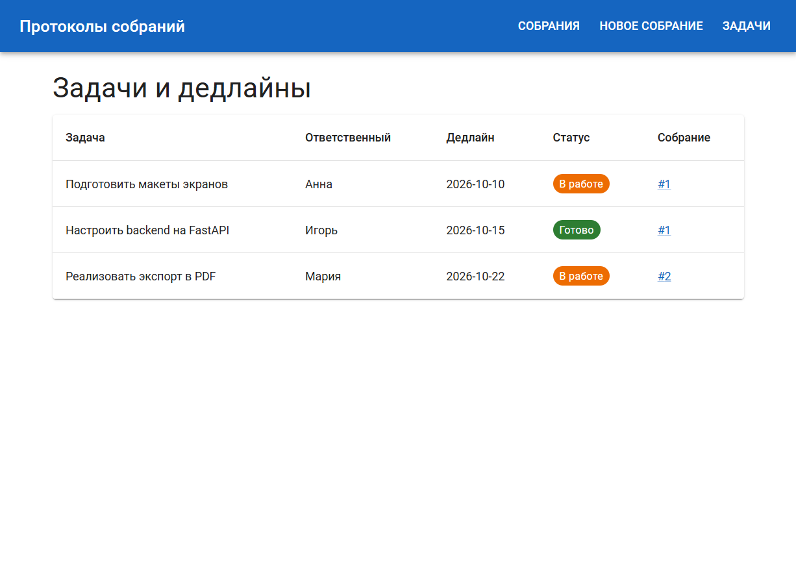
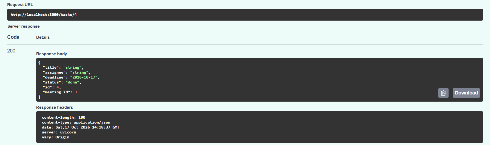
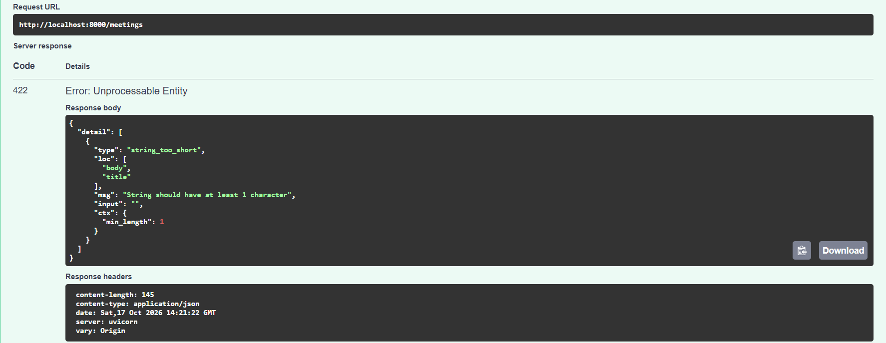
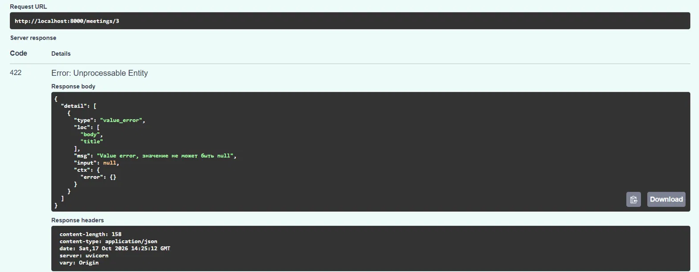
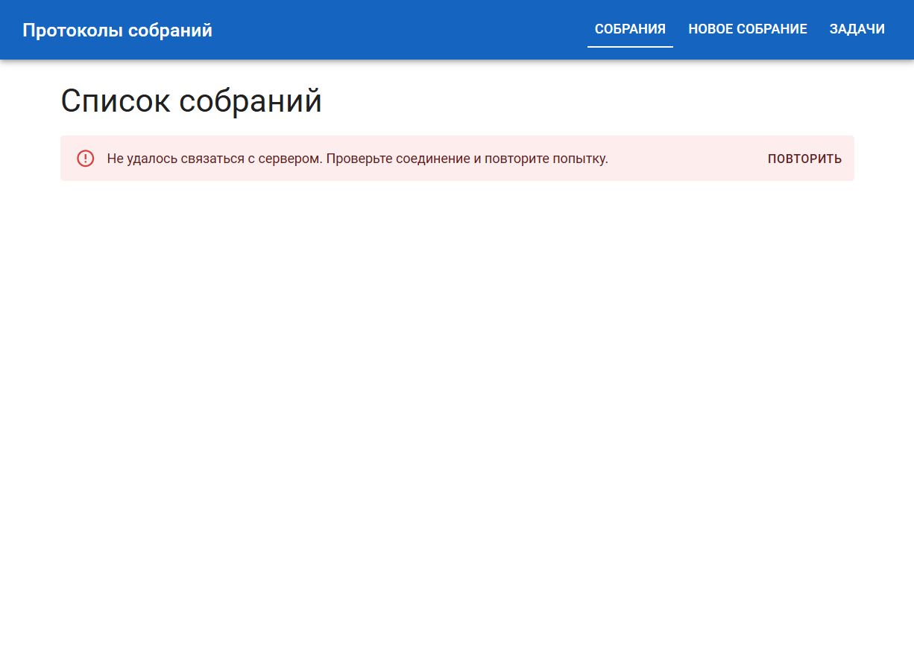
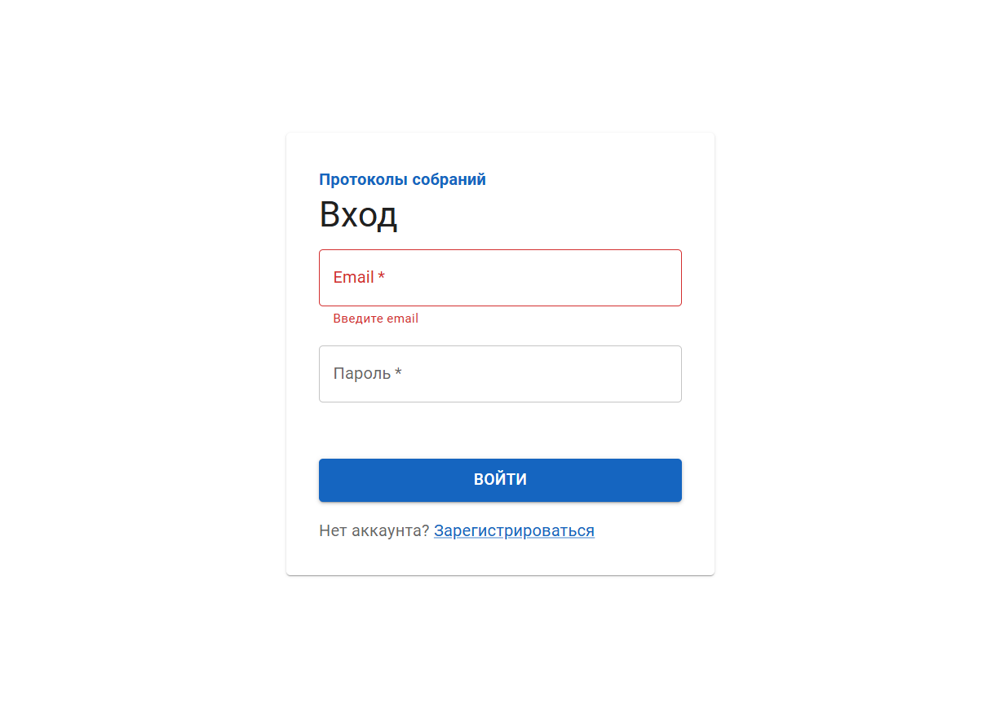
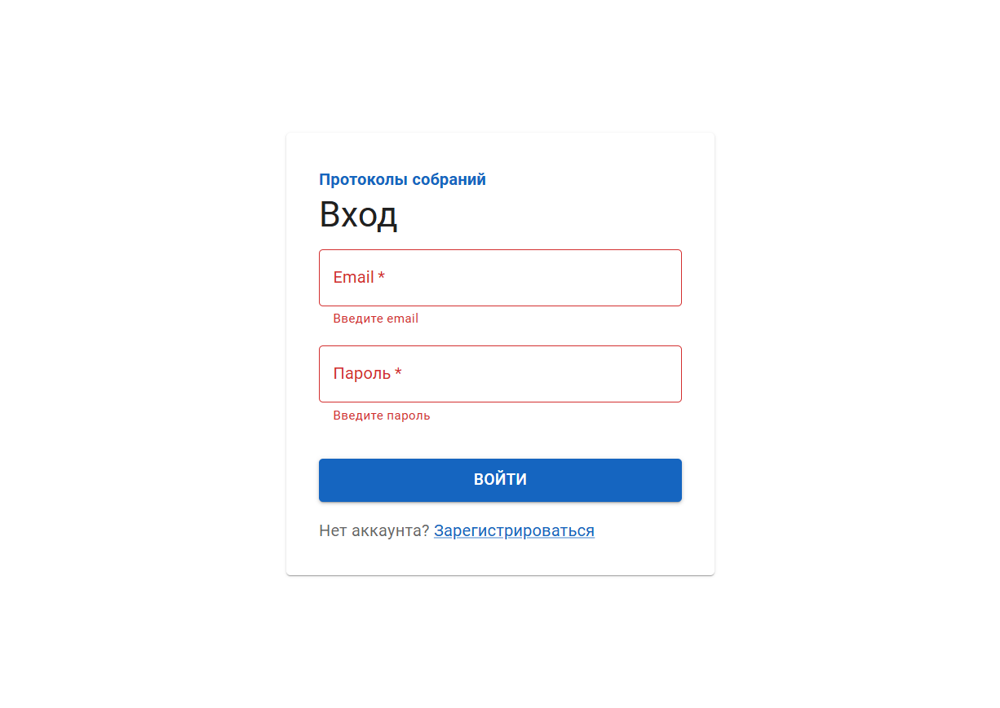
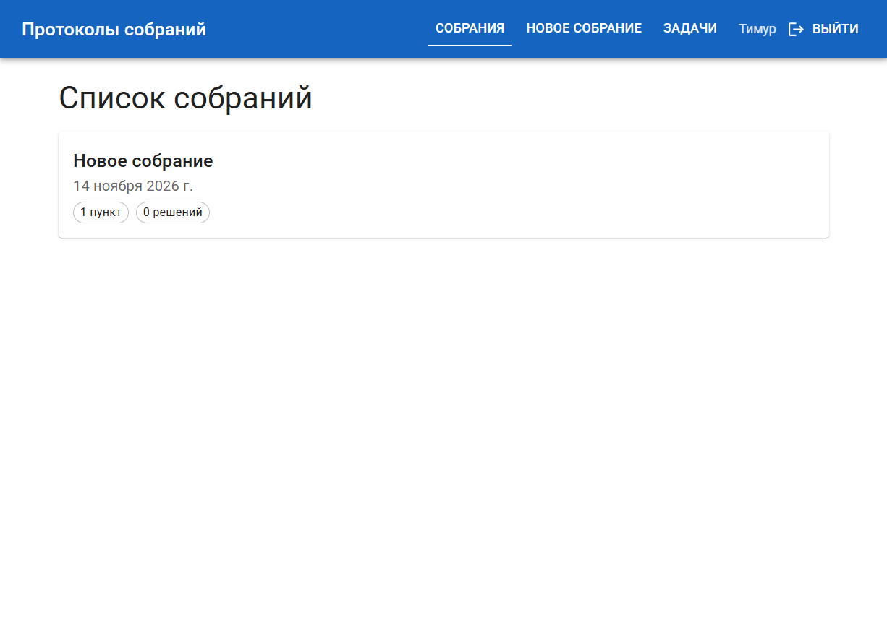
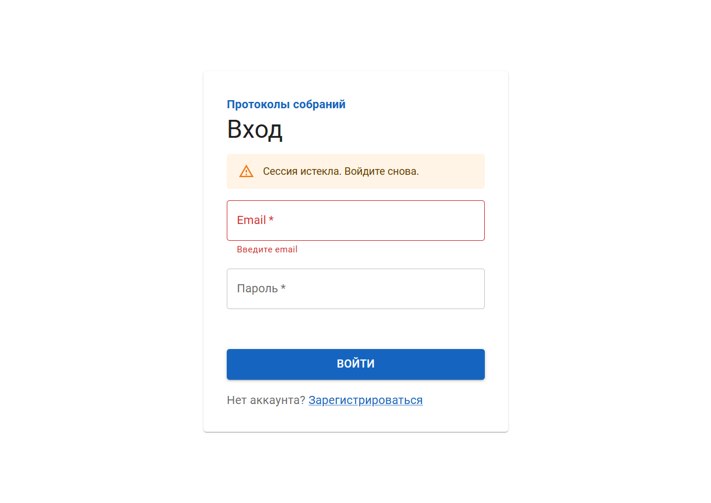
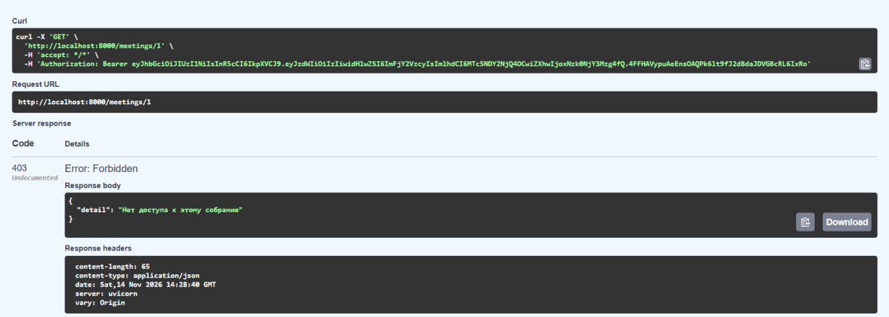

# Протоколы собраний

Веб-приложение для ведения протоколов собраний: планирование повестки, фиксация задач и дедлайнов,
ИИ-суммаризация обсуждений и аудиозаписей с выделением решений.

Проект учебный (курс «Fullstack», 1 семестр), разрабатывается поэтапно. Сейчас выполнены:
- **ЛР №1** — интерфейс и каркас frontend (на демонстрационных данных);
- **ЛР №2** — backend, API и база данных;
- **ЛР №3** — архитектура frontend и динамический интерфейс;
- **ЛР №4** — аутентификация и авторизация (регистрация, вход, access/refresh токены, защита API и маршрутов).

Начиная с ЛР №4 frontend работает с реальным backend: собрания и задачи берутся из API и доступны только после входа.

## Пользовательские сценарии
1. Посмотреть список собраний и открыть протокол.
2. Создать собрание: указать название, дату, повестку, загрузить аудиозапись.
3. Прочитать ИИ-резюме и принятые решения по собранию.
4. Отследить задачи, ответственных и дедлайны.

## Экраны
| Экран | Маршрут |
|---|---|
| Вход | `/login` (публичный) |
| Регистрация | `/register` (публичный) |
| Список собраний | `/` |
| Протокол собрания (повестка, ИИ-резюме, решения, задачи) | `/meetings/:id` |
| Новое собрание | `/new` |
| Задачи и дедлайны | `/tasks` |

Все экраны, кроме входа и регистрации, приватные: без входа открывается `/login`, а после входа пользователь
возвращается на запрошенную страницу.

## Стек
- Frontend: React + TypeScript, Vite, React Router, MUI (Material UI).
- Backend: Python 3.11+, FastAPI, SQLAlchemy 2.0, Pydantic v2, pydantic-settings, Uvicorn, PyJWT, argon2-cffi.
- База данных: PostgreSQL 16.
- Тесты: pytest + httpx (backend), проверка сборки (frontend). CI: GitHub Actions.

## Структура репозитория
```
backend/
  app/
    main.py         # создание приложения, CORS, роутеры, создание таблиц при старте
    config.py       # настройки из окружения / .env
    database.py     # engine, SessionLocal, Base, зависимость get_db
    models.py       # таблицы SQLAlchemy
    schemas.py      # схемы Pydantic (запросы и ответы)
    crud.py         # операции с БД
    security.py     # пароли (argon2id), JWT, генерация refresh token
    dependencies.py # get_current_user — защита маршрутов
    routers/        # auth.py, meetings.py, tasks.py
  tests/            # автотесты API
  .env.example      # пример настроек без секретов
  requirements.txt, requirements-dev.txt
src/                # frontend, структура описана в разделе «Архитектура frontend»
docs/screenshots/   # скриншоты экранов
docker-compose.yml  # PostgreSQL для разработки
.github/workflows/  # автоматическая проверка (CI)
```

## Архитектура frontend
Код разделён по упрощённой схеме Feature-Sliced Design. Слой может импортировать только слои ниже себя
(`app` → `pages` → `features` → `entities` → `shared`); импорты идут через `index.ts` среза, алиас `@/` = `src/`.

```
src/
  app/        # настройка приложения: тема MUI, маршрутизация, RequireAuth (защита маршрутов), общий каркас
  pages/      # экраны: login, register, meetings, meeting, new-meeting, tasks — собирают features и entities
  features/   # пользовательские действия
    auth-by-email/         # формы входа и регистрации + валидация
    logout/                # кнопка выхода
    create-meeting/        # форма нового собрания + валидация
    add-task/              # сворачиваемая форма добавления задачи + валидация
    change-task-status/    # смена статуса задачи
    filter-tasks/          # фильтр по статусу и поиск
  entities/   # сущности предметной области: типы, демо-данные, «API», базовые компоненты
    user/                  # User, AuthProvider и useAuth (состояние сессии), userApi
    meeting/               # Meeting, MeetingCard, meetingApi
    task/                  # Task, TaskStatusChip, DeadlineText, taskApi
  shared/     # общее без привязки к предметной области
    api/http.ts            # fetch-клиент: Bearer-токен, автообновление по refresh token
    api/tokenStorage.ts    # хранение токенов
    lib/                   # useAsync, validation, date, plural
    ui/AsyncBoundary.tsx   # единое отображение загрузки / ошибки / «нет данных»
```

Дублирование убрано: статус задачи, дедлайн и карточка собрания реализованы один раз в `entities` и
используются на нескольких страницах; состояния экранов с данными — один раз в `AsyncBoundary`.

### Интерактивность и типизация
- Формы: «Новое собрание» (название, дата, динамический список пунктов повестки, аудиофайл) и «Добавить задачу».
  Состояние управляется через `useState`; значения форм, ошибки и свойства компонентов описаны типами TypeScript.
- Клиентская валидация (`features/*/model/validation.ts`): обязательные поля, длина, корректность даты,
  тип и размер аудиофайла (до 50 МБ). Ошибки показываются под полем после ухода из поля или при попытке сохранить;
  на время «сохранения» поля блокируются, при сбое показывается сообщение.
- Экраны с данными: **загрузка** (скелетоны), **ошибка** (с кнопкой «Повторить»), **нет данных** (с призывом к действию);
  отдельно — «ничего не найдено» при фильтрации задач.
- Действия пользователя: смена статуса задачи (с индикатором запроса), фильтр и поиск задач, добавление задач,
  создание собрания с переходом на его протокол. Просроченные задачи выделяются красным.
- Анимации: плавное появление экранов при переходе, появление карточек и блоков (`Grow`), раскрытие форм и
  добавление/удаление пунктов повестки (`Collapse`), появление и скрытие строк таблицы при фильтрации (`Fade`),
  подъём карточки при наведении. Анимации отключаются при системной настройке «уменьшить движение».

## Запуск frontend
Нужен Node.js 18+. Для работы должен быть запущен backend (см. ниже).
```bash
npm install
npm run dev      # http://localhost:5173
npm run build    # проверка типов и сборки
```
Адрес API задаётся переменной `VITE_API_URL` (по умолчанию `http://localhost:8000`): при необходимости
скопируйте `.env.example` в `.env` и измените значение. Если frontend открыт на другом адресе, добавьте его
в `CORS_ORIGINS` в `backend/.env`.

## Запуск backend
Нужны Python 3.11+ и Docker (или установленный PostgreSQL).

```bash
# 1. Настройки окружения (в .env реальные значения, он не попадает в Git)
cp backend/.env.example backend/.env       # измените пароль БД и JWT_SECRET_KEY

# 2. База данных (из корня репозитория)
docker compose --env-file backend/.env up -d db

# 3. Зависимости и запуск (из каталога backend)
cd backend
python -m venv .venv
source .venv/bin/activate                  # Windows: .venv\Scripts\activate
pip install -r requirements.txt
uvicorn app.main:app --reload
```

- Таблицы создаются автоматически при старте приложения (`Base.metadata.create_all`);
  существующие таблицы не изменяются. **В ЛР №4 схема изменилась** (таблицы `users`, `refresh_tokens`,
  колонка `meetings.owner_id`): если БД создавалась раньше, пересоздайте её вместе с данными —
  `docker compose --env-file backend/.env down -v`, затем снова `docker compose --env-file backend/.env up -d db`.
- `JWT_SECRET_KEY` обязателен и не короче 32 символов; сгенерировать:
  `python -c "import secrets; print(secrets.token_hex(32))"`.
- Без Docker создайте БД и пользователя в своём PostgreSQL и впишите их в `backend/.env`.
- Запускайте `uvicorn` из каталога `backend`: именно там ищется файл `.env`.
- Документация и ручная проверка: http://localhost:8000/docs (Swagger UI).

## Модель данных
Основная сущность — собрание (`meetings`). Повестка, решения и задачи относятся к одному собранию
(связь «один ко многим»). Собрание принадлежит пользователю (`owner_id`); задачи, повестка и решения
наследуют владельца через собрание.

| Таблица | Поля |
|---|---|
| `users` | `id` (PK), `email` (уникальный), `name`, `password_hash`, `created_at` |
| `refresh_tokens` | `id` (PK), `user_id` (FK → users.id), `token_hash` (уникальный), `created_at`, `expires_at`, `revoked_at` |
| `meetings` | `id` (PK), `owner_id` (FK → users.id), `title`, `date`, `summary`, `audio_path` |
| `agenda_items` | `id` (PK), `meeting_id` (FK → meetings.id), `position`, `text` |
| `decisions` | `id` (PK), `meeting_id` (FK → meetings.id), `text` |
| `tasks` | `id` (PK), `meeting_id` (FK → meetings.id), `title`, `assignee`, `deadline`, `status` |

- Внешние ключи объявлены с `ON DELETE CASCADE`, а в SQLAlchemy у связей стоит `cascade="all, delete-orphan"`:
  при удалении собрания удаляются его повестка, решения и задачи.
- `tasks.status`: `in_progress` («В работе»), `done` («Готово»), `postponed` («Отложена»).
  Во frontend используются те же значения `status`.
- В API повестка и решения передаются списками строк, разбиение на строки таблиц делает backend.

## API
| Метод | Адрес | Описание | Успех |
|---|---|---|---|
| POST | `/auth/register` | регистрация (`email`, `name`, `password`) | 201 |
| POST | `/auth/login` | вход: форма `username` (email) + `password`; выдаёт access и refresh токены | 200 |
| POST | `/auth/refresh` | новая пара токенов по refresh token (использованный отзывается) | 200 |
| POST | `/auth/logout` | отозвать refresh token текущей сессии | 204 |
| GET | `/auth/me` | текущий пользователь 🔒 | 200 |
| GET | `/meetings` | список собраний (`skip`, `limit`) 🔒 | 200 |
| POST | `/meetings` | создать собрание с повесткой и решениями 🔒 | 201 |
| GET | `/meetings/{id}` | собрание с повесткой, решениями и задачами 🔒 | 200 |
| PATCH | `/meetings/{id}` | изменить поля; переданные `agenda`/`decisions` заменяют список целиком 🔒 | 200 |
| DELETE | `/meetings/{id}` | удалить собрание со связанными записями 🔒 | 204 |
| GET | `/tasks` | список задач (фильтры `meeting_id`, `status`) 🔒 | 200 |
| POST | `/tasks` | создать задачу (`meeting_id` в теле) 🔒 | 201 |
| GET | `/tasks/{id}` | одна задача 🔒 | 200 |
| PATCH | `/tasks/{id}` | изменить поля задачи 🔒 | 200 |
| DELETE | `/tasks/{id}` | удалить задачу 🔒 | 204 |
| GET | `/health` | проверка работы сервиса | 200 |

🔒 — приватный маршрут: нужен заголовок `Authorization: Bearer <access token>`.

Ошибки:
- `401` — нет токена, токен некорректен или истёк, неверный email/пароль, refresh token недействителен;
- `403` — собрание или задача принадлежит другому пользователю;
- `409` — email уже зарегистрирован;
- `404` с понятным текстом (`{"detail": "Собрание с id=9999 не найдено"}`), в том числе при создании задачи
  для несуществующего собрания;
- `422` при некорректных данных: пустое название, неверная дата или статус, нечисловой id,
  явный `null` в обязательных полях при PATCH.

## Тесты и автопроверка
Автотесты API не требуют PostgreSQL: база подменяется SQLite в памяти.

```bash
cd backend
pip install -r requirements-dev.txt
pytest -v
```

Тесты покрывают: регистрацию, вход, токены, refresh, выход и разграничение доступа (`tests/test_auth.py`), CRUD собраний и задач, фильтры, ошибки 404 и 422, замену повестки и решений при PATCH,
каскадное удаление (после удаления собрания в `agenda_items`, `decisions`, `tasks` не остаётся его строк).

При каждом push GitHub Actions (`.github/workflows/ci.yml`) запускает `pytest` для backend
и `npm run build` для frontend.

Ручная проверка на реальном PostgreSQL описана в разделе «Проверка на PostgreSQL» ниже.

## Скриншоты
Лежат в `docs/screenshots/`.

### Список собраний


### Протокол собрания


### Новое собрание


### Задачи и дедлайны


## Проверка на PostgreSQL
Ручная проверка API через Swagger на реальной БД. Скриншоты лежат в `docs/api-check/`.

### Создание
Создание собрания с повесткой и решениями (201):


Создание задачи (201):


### Чтение
Чтение собрания со связанной задачей (200):


Фильтр задач по статусу (200):


### Изменение и удаление
Изменение задачи (200):



Удаление собрания (204):


Каскад: задача удалена вместе с собранием, запрос задачи даёт 404:


### Ошибки
Несуществующее собрание (404):


Пустое название собрания (422):



`null` в обязательном поле при изменении (422):



## Аутентификация и авторизация (ЛР №4)

### Как это работает
1. **Регистрация** `POST /auth/register`: email (приводится к нижнему регистру, уникален), имя, пароль 8–128 символов.
   Пароль хранится только как хеш **argon2id** (`argon2-cffi`, параметры по умолчанию) — алгоритм, предназначенный
   для паролей: с солью и настраиваемой стоимостью. Ответ не содержит пароль или хеш.
2. **Вход** `POST /auth/login` (форма OAuth2: `username` = email, `password`) выдаёт два токена:
   - **access token** — JWT (HS256, подпись `JWT_SECRET_KEY`), claims `sub` (id пользователя), `type=access`, `iat`, `exp`;
     срок `ACCESS_TOKEN_EXPIRE_MINUTES` (по умолчанию 15 минут);
   - **refresh token** — случайная строка (`secrets.token_urlsafe(48)`); срок `REFRESH_TOKEN_EXPIRE_DAYS` (по умолчанию 7 дней).
     В БД лежит только его SHA-256, поэтому утечка таблицы не даёт рабочих токенов. Отзыв возможен, так как токен —
     запись в таблице `refresh_tokens` (одна запись = одна сессия).
3. **Обновление** `POST /auth/refresh`: по действующему refresh token выдаётся новая пара, а использованный токен
   отзывается (ротация). Ответ `401`, если токен неизвестен, истёк, отозван или вместо него передан access token.
4. **Текущий пользователь** `GET /auth/me`. Защита маршрутов — зависимость `get_current_user`: проверяет подпись, срок,
   тип токена и существование пользователя. Публичны только `/health` и `/auth/register|login|refresh|logout`;
   все `/meetings*` и `/tasks*` приватны.
5. **Выход** `POST /auth/logout`: отзывает refresh token текущей сессии, поэтому обновить access token им больше нельзя.
   Другие сессии пользователя (например, на другом устройстве) продолжают работать. Запрос идемпотентен.

### Права доступа
Данные принадлежат пользователю: собрание хранит `owner_id`, задачи проверяются по владельцу своего собрания.
Список собраний и задач содержит только записи текущего пользователя. Чтение, изменение и удаление чужой записи
дают `403`, несуществующей — `404`. Создать задачу в чужом собрании нельзя.

### Frontend
- `shared/api/http.ts` добавляет `Authorization: Bearer …` ко всем приватным запросам. При `401` он один раз обновляет
  токены и повторяет запрос; параллельные запросы ждут одно общее обновление (refresh token одноразовый).
  Если обновить не удалось, токены очищаются, пользователь попадает на `/login` с сообщением «Сессия истекла».
- Access token хранится в памяти, refresh token — в `localStorage`. После перезагрузки страницы сессия
  восстанавливается по refresh token (`AuthProvider`: refresh → `/auth/me`). Выход в одной вкладке завершает
  сессию и в остальных (событие `storage`).
- `RequireAuth` в `app/` закрывает приватные маршруты, `GuestOnly` не пускает вошедшего на `/login` и `/register`.
- «Выйти» в шапке отзывает refresh token на сервере и очищает состояние на клиенте (даже если сервер недоступен).
- Формы входа и регистрации валидируются на клиенте (email, длина пароля, совпадение паролей); ошибки сервера
  показываются понятно: «Неверный email или пароль», «Пользователь с таким email уже существует».

### Ограничения (осознанные упрощения)
- `localStorage` доступен скриптам страницы, то есть уязвим при XSS; в production refresh token лучше хранить
  в `httpOnly`-cookie.
- Access token — без состояния, поэтому после выхода он действует до истечения срока (до 15 минут); отозвать можно только refresh token.
- Нет ограничения числа попыток входа и подтверждения email.
- Аудиофайл при создании собрания пока не загружается на сервер: сохраняется только его имя.

### Как проверить вручную
1. Запустите backend и frontend. Откройте http://localhost:5173 — откроется `/login`.
2. Зарегистрируйтесь, затем убедитесь, что открылся список собраний, а в шапке видно имя.
3. Обновите страницу — вы остались в системе. Нажмите «Выйти» — вернулись на `/login`, а прямой переход на `/tasks` снова ведёт на вход.
4. В Swagger (http://localhost:8000/docs) нажмите **Authorize**, введите email и пароль — приватные методы станут доступны.
5. Зарегистрируйте второго пользователя: чужие собрания не видны в списке, а запрос `GET /meetings/{id}` чужого собрания возвращает `403`.
6. Чтобы быстро увидеть истечение access token, поставьте `ACCESS_TOKEN_EXPIRE_MINUTES=1` и перезапустите backend:
   через минуту frontend незаметно обновит токены и продолжит работу.

## Изменения интерфейса (ЛР №4)
- Новые экраны «Вход» и «Регистрация»; в шапке — имя пользователя и кнопка «Выйти».
- Список собраний, протокол и задачи теперь загружаются из API (имитация сервера и режимы `?demo=` удалены);
  в карточке собрания количество пунктов и решений приходит с сервера.

## Изменения интерфейса (ЛР №3)
**ЛР №3.**
- Экран «Новое собрание»: кнопка «Сохранить» теперь работает (на демонстрационных данных): форма проверяется,
  собрание создаётся, открывается его протокол. Повестка вводится не одним текстовым полем, а списком пунктов:
  так проще валидировать каждый пункт.
- Статус задачи вместо булева `done` (готово / нет) стал перечислением `in_progress | done | postponed`, как в backend.
- «Протокол собрания» и «Задачи»: добавлены форма создания задачи, смена статуса, фильтры и поиск,
  выделение просроченных дедлайнов; в таблице задач вместо `#id` показано название собрания.
- Во всех экранах добавлены состояния загрузки, ошибки и отсутствия данных.
- Скриншоты ЛР №3 лежат в `docs/lab3/`; список кадров — ниже.

## Скриншоты ЛР №3
Лежат в `docs/lab3/`. Кадры сняты в ЛР №3 на демонстрационных данных (режимы `?demo=` в ЛР №4 удалены вместе с имитацией сервера).

### Список собраний


### Протокол собрания


### Новое собрание
Ошибки валидации при пустой форме:


Заполненная форма с несколькими пунктами повестки:


### Задачи и дедлайны


Форма добавления задачи:


Фильтр без результатов:


### Состояния загрузки, пустого списка и ошибки
Загрузка (`/?demo=slow`):


Нет данных (`/?demo=empty`):


Ошибка (`/?demo=error`):



## Скриншоты ЛР №4
Лежат в `docs/lab4/`.

### Вход
Форма входа:



Ошибки валидации при пустых полях:



Ответ сервера при неверном email или пароле:


### Регистрация
Форма регистрации:


Ошибки валидации (некорректный email, короткий пароль, пароли не совпадают):


Регистрация с уже занятым email:


### Экраны приложения после входа
В шапке теперь видны имя пользователя и кнопка «Выйти».

Список собраний:



Протокол собрания:


Новое собрание:


Задачи и дедлайны:


### Сессия и адаптивность
Сообщение при истёкшей сессии (refresh token недействителен):



Список собраний на узком экране (телефон):


### Проверка защиты API в Swagger
Авторизация в Swagger (кнопка Authorize):


Запрос без токена, ответ 401:


Чужое собрание, ответ 403:

