# Протоколы собраний

Веб-приложение для ведения протоколов собраний: планирование повестки, фиксация задач и дедлайнов,
ИИ-суммаризация обсуждений и аудиозаписей с выделением решений.

Проект учебный (курс «Fullstack», 1 семестр), разрабатывается поэтапно. Сейчас выполнены:
- **ЛР №1** — интерфейс и каркас frontend (на демонстрационных данных);
- **ЛР №2** — backend, API и база данных;
- **ЛР №3** — архитектура frontend и динамический интерфейс (на демонстрационных данных).

Подключение frontend к API — следующий этап.

## Пользовательские сценарии
1. Посмотреть список собраний и открыть протокол.
2. Создать собрание: указать название, дату, повестку, загрузить аудиозапись.
3. Прочитать ИИ-резюме и принятые решения по собранию.
4. Отследить задачи, ответственных и дедлайны.

## Экраны
| Экран | Маршрут |
|---|---|
| Список собраний | `/` |
| Протокол собрания (повестка, ИИ-резюме, решения, задачи) | `/meetings/:id` |
| Новое собрание | `/new` |
| Задачи и дедлайны | `/tasks` |

## Стек
- Frontend: React + TypeScript, Vite, React Router, MUI (Material UI).
- Backend: Python 3.11+, FastAPI, SQLAlchemy 2.0, Pydantic v2, pydantic-settings, Uvicorn.
- База данных: PostgreSQL 16.
- Тесты: pytest + httpx (backend), проверка сборки (frontend). CI: GitHub Actions.

## Структура репозитория
```
backend/
  app/
    main.py         # создание приложения, CORS, роутеры, создание таблиц при старте
    config.py       # настройки из окружения / .env
    database.py     # engine, SessionLocal, Base, зависимость get_db
    models.py       # таблицы SQLAlchemy
    schemas.py      # схемы Pydantic (запросы и ответы)
    crud.py         # операции с БД
    routers/        # meetings.py, tasks.py
  tests/            # автотесты API
  .env.example      # пример настроек без секретов
  requirements.txt, requirements-dev.txt
src/                # frontend, структура описана в разделе «Архитектура frontend»
docs/screenshots/   # скриншоты экранов
docker-compose.yml  # PostgreSQL для разработки
.github/workflows/  # автоматическая проверка (CI)
```

## Архитектура frontend
Код разделён по упрощённой схеме Feature-Sliced Design. Слой может импортировать только слои ниже себя
(`app` → `pages` → `features` → `entities` → `shared`); импорты идут через `index.ts` среза, алиас `@/` = `src/`.

```
src/
  app/        # настройка приложения: тема MUI, маршрутизация, общий каркас (шапка, переход между экранами)
  pages/      # экраны: meetings, meeting, new-meeting, tasks — собирают features и entities
  features/   # пользовательские действия
    create-meeting/        # форма нового собрания + валидация
    add-task/              # сворачиваемая форма добавления задачи + валидация
    change-task-status/    # смена статуса задачи
    filter-tasks/          # фильтр по статусу и поиск
  entities/   # сущности предметной области: типы, демо-данные, «API», базовые компоненты
    meeting/               # Meeting, MeetingCard, meetingApi
    task/                  # Task, TaskStatusChip, DeadlineText, taskApi
  shared/     # общее без привязки к предметной области
    api/fakeServer.ts      # имитация сервера: задержка, ошибки, режимы демо
    lib/                   # useAsync, validation, date, plural
    ui/AsyncBoundary.tsx   # единое отображение загрузки / ошибки / «нет данных»
```

Дублирование убрано: статус задачи, дедлайн и карточка собрания реализованы один раз в `entities` и
используются на нескольких страницах; состояния экранов с данными — один раз в `AsyncBoundary`.

### Интерактивность и типизация
- Формы: «Новое собрание» (название, дата, динамический список пунктов повестки, аудиофайл) и «Добавить задачу».
  Состояние управляется через `useState`; значения форм, ошибки и свойства компонентов описаны типами TypeScript.
- Клиентская валидация (`features/*/model/validation.ts`): обязательные поля, длина, корректность даты,
  тип и размер аудиофайла (до 50 МБ). Ошибки показываются под полем после ухода из поля или при попытке сохранить;
  на время «сохранения» поля блокируются, при сбое показывается сообщение.
- Экраны с данными: **загрузка** (скелетоны), **ошибка** (с кнопкой «Повторить»), **нет данных** (с призывом к действию);
  отдельно — «ничего не найдено» при фильтрации задач.
- Действия пользователя: смена статуса задачи (с индикатором запроса), фильтр и поиск задач, добавление задач,
  создание собрания с переходом на его протокол. Просроченные задачи выделяются красным.
- Анимации: плавное появление экранов при переходе, появление карточек и блоков (`Grow`), раскрытие форм и
  добавление/удаление пунктов повестки (`Collapse`), появление и скрытие строк таблицы при фильтрации (`Fade`),
  подъём карточки при наведении. Анимации отключаются при системной настройке «уменьшить движение».

### Проверка состояний
Режим демо-данных задаётся параметром адреса при загрузке страницы:

| Адрес | Что показывает |
|---|---|
| `http://localhost:5173/` | обычный режим |
| `http://localhost:5173/?demo=slow` | долгая загрузка (состояние «загрузка») |
| `http://localhost:5173/?demo=empty` | пустые списки (состояние «нет данных») |
| `http://localhost:5173/?demo=error` | ошибка сервера (состояние «ошибка», создание и смена статуса тоже завершаются ошибкой) |

## Запуск frontend
Нужен Node.js 18+.
```bash
npm install
npm run dev      # http://localhost:5173
npm run build    # проверка типов и сборки
```
Пока frontend использует демонстрационные данные: они лежат в `src/entities/*/model/demoData.ts`,
а запросы к «серверу» имитирует `src/shared/api/fakeServer.ts` (данные живут в памяти до перезагрузки страницы).

## Запуск backend
Нужны Python 3.11+ и Docker (или установленный PostgreSQL).

```bash
# 1. Настройки окружения (в .env реальные значения, он не попадает в Git)
cp backend/.env.example backend/.env       # при желании измените пароль

# 2. База данных (из корня репозитория)
docker compose --env-file backend/.env up -d db

# 3. Зависимости и запуск (из каталога backend)
cd backend
python -m venv .venv
source .venv/bin/activate                  # Windows: .venv\Scripts\activate
pip install -r requirements.txt
uvicorn app.main:app --reload
```

- Таблицы создаются автоматически при старте приложения (`Base.metadata.create_all`);
  существующие таблицы не изменяются.
- Без Docker создайте БД и пользователя в своём PostgreSQL и впишите их в `backend/.env`.
- Запускайте `uvicorn` из каталога `backend`: именно там ищется файл `.env`.
- Документация и ручная проверка: http://localhost:8000/docs (Swagger UI).

## Модель данных
Основная сущность — собрание (`meetings`). Повестка, решения и задачи относятся к одному собранию
(связь «один ко многим»).

| Таблица | Поля |
|---|---|
| `meetings` | `id` (PK), `title`, `date`, `summary`, `audio_path` |
| `agenda_items` | `id` (PK), `meeting_id` (FK → meetings.id), `position`, `text` |
| `decisions` | `id` (PK), `meeting_id` (FK → meetings.id), `text` |
| `tasks` | `id` (PK), `meeting_id` (FK → meetings.id), `title`, `assignee`, `deadline`, `status` |

- Внешние ключи объявлены с `ON DELETE CASCADE`, а в SQLAlchemy у связей стоит `cascade="all, delete-orphan"`:
  при удалении собрания удаляются его повестка, решения и задачи.
- `tasks.status`: `in_progress` («В работе»), `done` («Готово»), `postponed` («Отложена»).
  Во frontend используются те же значения `status`.
- В API повестка и решения передаются списками строк, разбиение на строки таблиц делает backend.

## API
| Метод | Адрес | Описание | Успех |
|---|---|---|---|
| GET | `/meetings` | список собраний (`skip`, `limit`) | 200 |
| POST | `/meetings` | создать собрание с повесткой и решениями | 201 |
| GET | `/meetings/{id}` | собрание с повесткой, решениями и задачами | 200 |
| PATCH | `/meetings/{id}` | изменить поля; переданные `agenda`/`decisions` заменяют список целиком | 200 |
| DELETE | `/meetings/{id}` | удалить собрание со связанными записями | 204 |
| GET | `/tasks` | список задач (фильтры `meeting_id`, `status`) | 200 |
| POST | `/tasks` | создать задачу (`meeting_id` в теле) | 201 |
| GET | `/tasks/{id}` | одна задача | 200 |
| PATCH | `/tasks/{id}` | изменить поля задачи | 200 |
| DELETE | `/tasks/{id}` | удалить задачу | 204 |
| GET | `/health` | проверка работы сервиса | 200 |

Ошибки:
- `404` с понятным текстом (`{"detail": "Собрание с id=9999 не найдено"}`), в том числе при создании задачи
  для несуществующего собрания;
- `422` при некорректных данных: пустое название, неверная дата или статус, нечисловой id,
  явный `null` в обязательных полях при PATCH.

## Тесты и автопроверка
Автотесты API не требуют PostgreSQL: база подменяется SQLite в памяти.

```bash
cd backend
pip install -r requirements-dev.txt
pytest -v
```

Тесты покрывают: CRUD собраний и задач, фильтры, ошибки 404 и 422, замену повестки и решений при PATCH,
каскадное удаление (после удаления собрания в `agenda_items`, `decisions`, `tasks` не остаётся его строк).

При каждом push GitHub Actions (`.github/workflows/ci.yml`) запускает `pytest` для backend
и `npm run build` для frontend.

Ручная проверка на реальном PostgreSQL описана в разделе «Проверка на PostgreSQL» ниже.

## Скриншоты
Лежат в `docs/screenshots/`.

### Список собраний
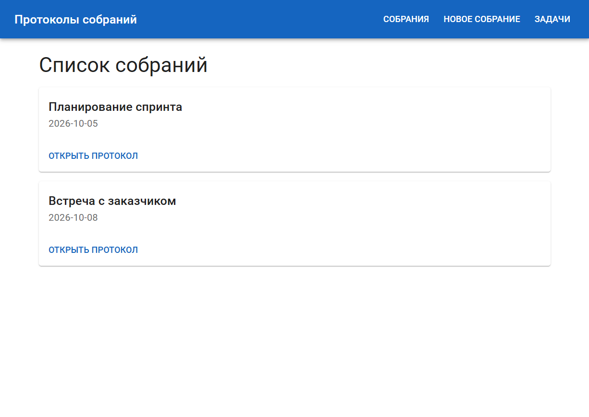

### Протокол собрания


### Новое собрание
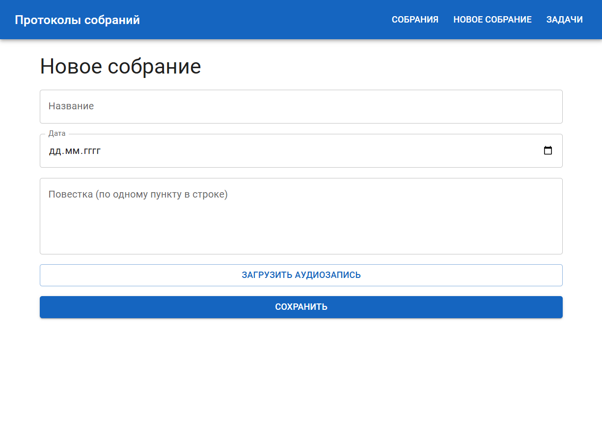

### Задачи и дедлайны


## Проверка на PostgreSQL
Ручная проверка API через Swagger на реальной БД. Скриншоты лежат в `docs/api-check/`.

| Проверка | Результат |
|---|---|
| Создание собрания с повесткой и решениями | 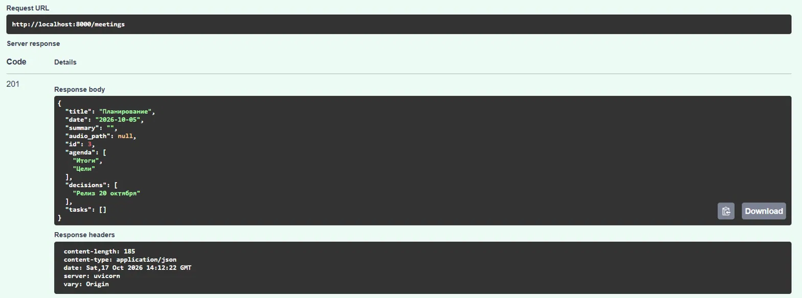 |
| Создание задачи | 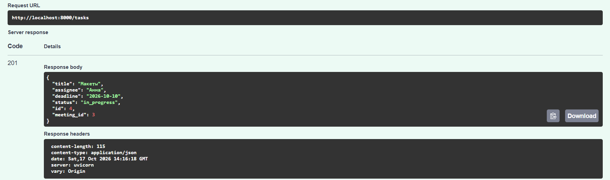 |
| Чтение собрания со связанной задачей | 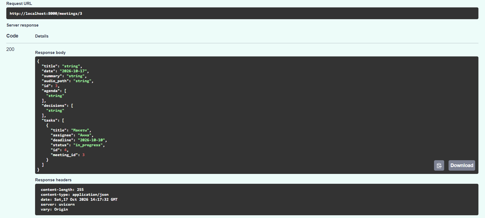 |
| Изменение задачи |  |
| Фильтр задач по статусу |  |
| Несуществующее собрание (404) | 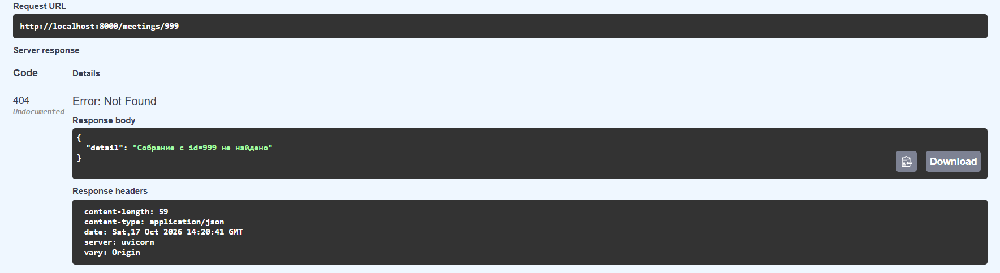 |
| Пустое название (422) |  |
| `null` в обязательном поле (422) |  |
| Удаление собрания | 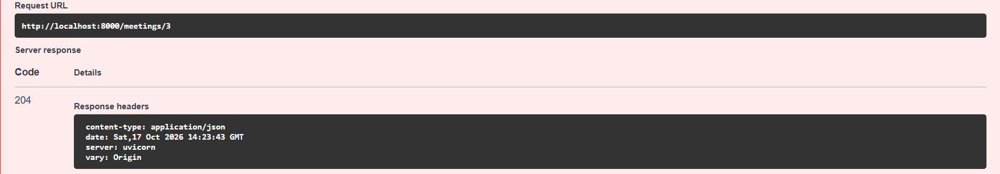 |
| Каскад: задача удалена вместе с собранием |  |

## Изменения интерфейса
**ЛР №3.**
- Экран «Новое собрание»: кнопка «Сохранить» теперь работает (на демонстрационных данных): форма проверяется,
  собрание создаётся, открывается его протокол. Повестка вводится не одним текстовым полем, а списком пунктов:
  так проще валидировать каждый пункт.
- Статус задачи вместо булева `done` (готово / нет) стал перечислением `in_progress | done | postponed`, как в backend.
- «Протокол собрания» и «Задачи»: добавлены форма создания задачи, смена статуса, фильтры и поиск,
  выделение просроченных дедлайнов; в таблице задач вместо `#id` показано название собрания.
- Во всех экранах добавлены состояния загрузки, ошибки и отсутствия данных.
- Скриншоты в `docs/lab3/` нужно обновить; список кадров — ниже.

## Скриншоты ЛР №3
Лежат в `docs/lab3/`. Состояния экранов проверяются параметром адреса `?demo=slow|empty|error`.

### Список собраний
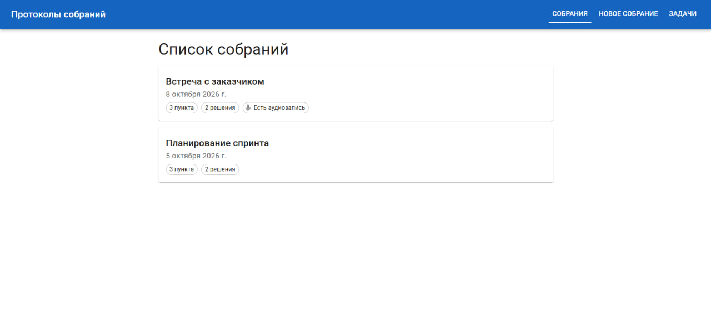

### Протокол собрания
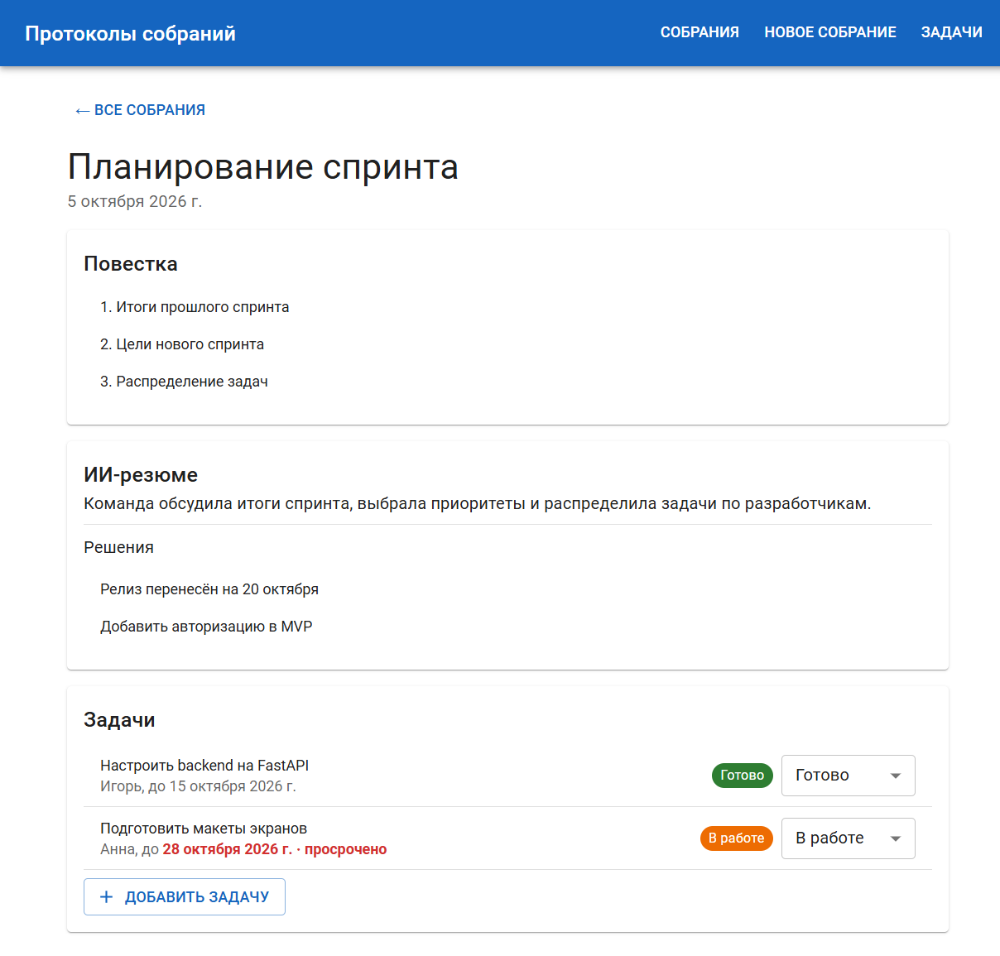

### Новое собрание
Ошибки валидации при пустой форме:

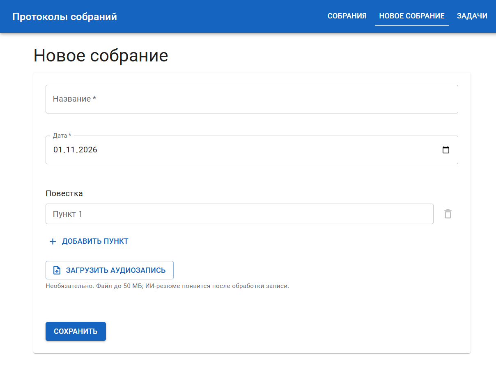

Заполненная форма с несколькими пунктами повестки:

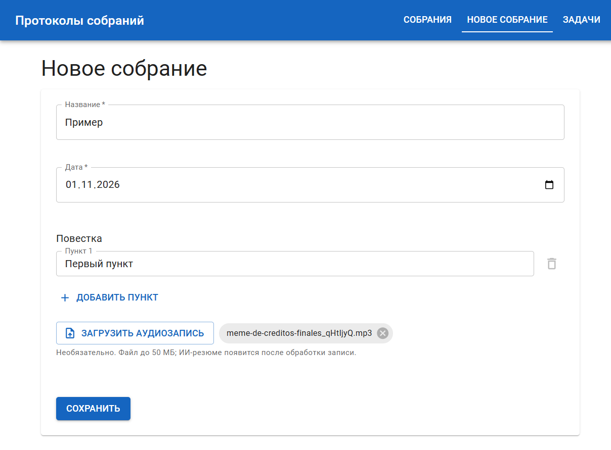

### Задачи и дедлайны
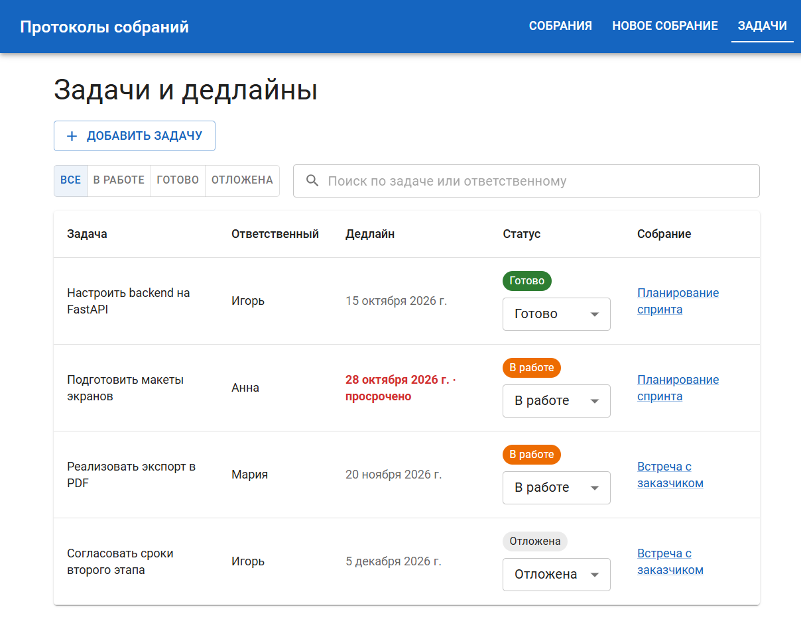

Форма добавления задачи:


Фильтр без результатов:


### Состояния загрузки, пустого списка и ошибки
Загрузка (`/?demo=slow`):

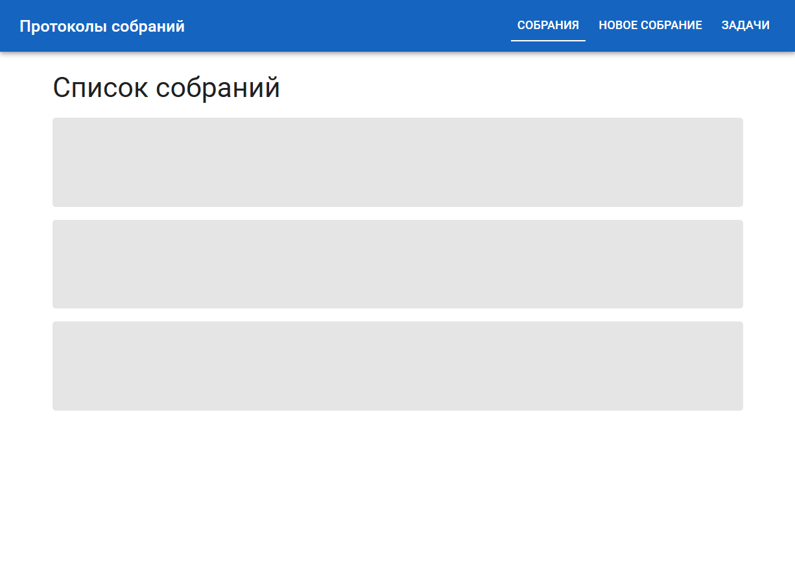

Нет данных (`/?demo=empty`):


Ошибка (`/?demo=error`):


Кнопка «Сохранить» пока не обращается к backend: подключение к API — следующий этап.
