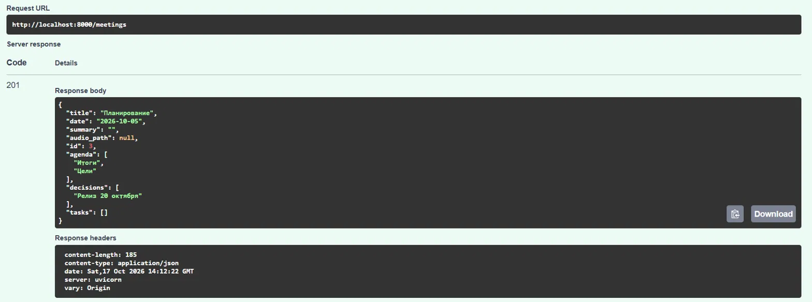
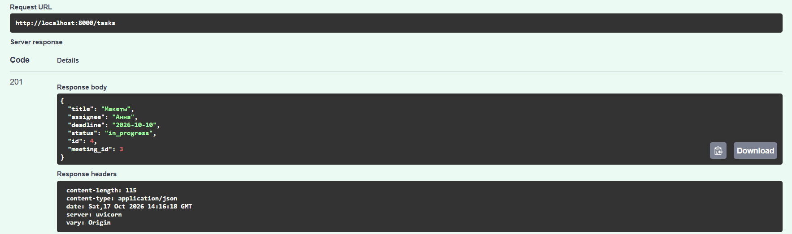
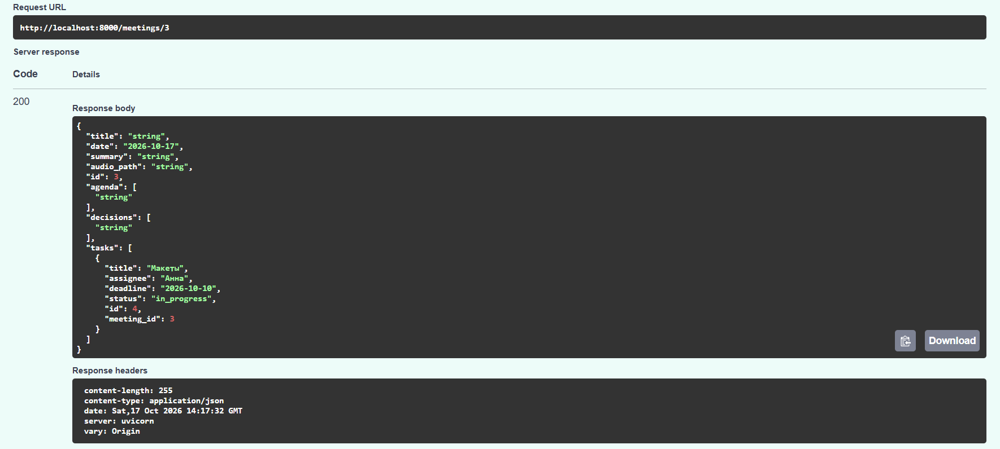
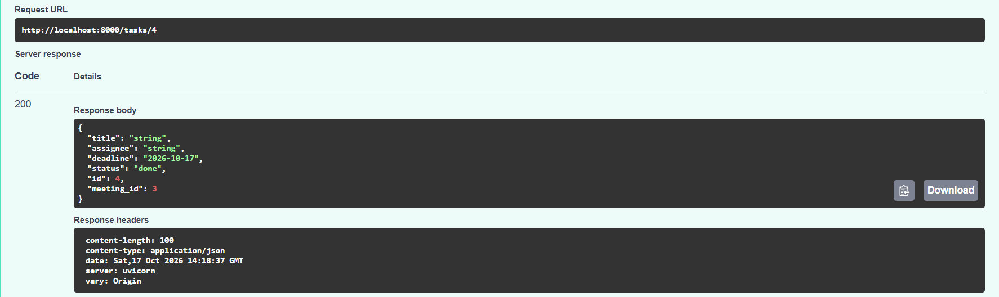
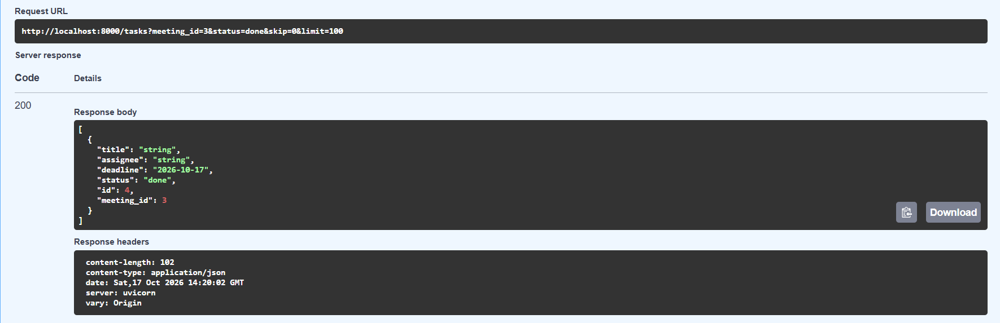
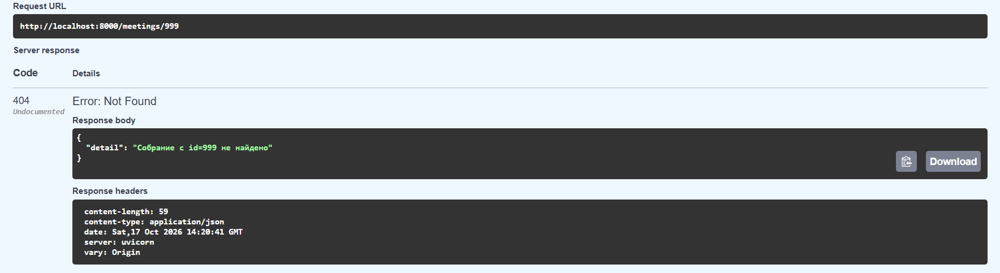
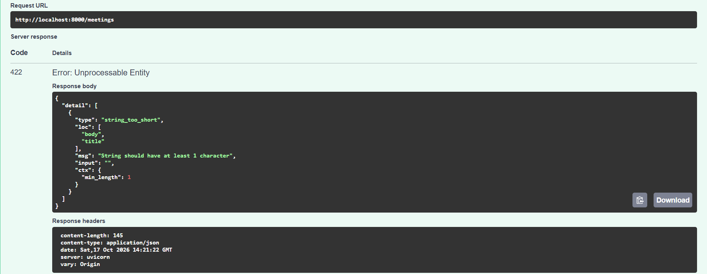
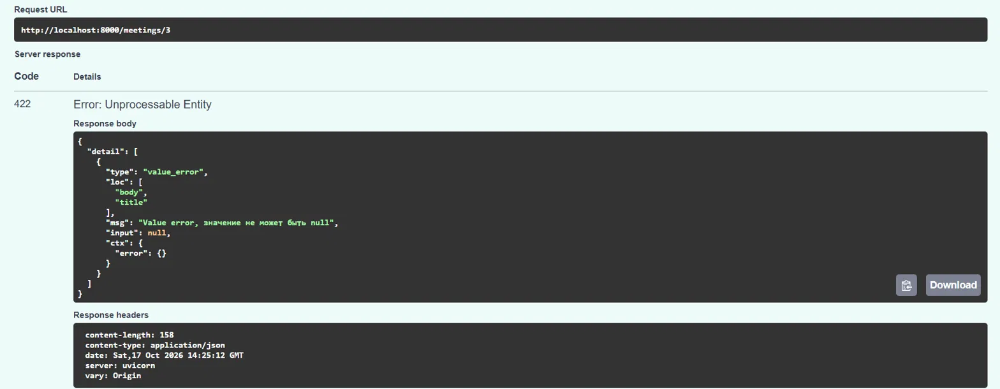
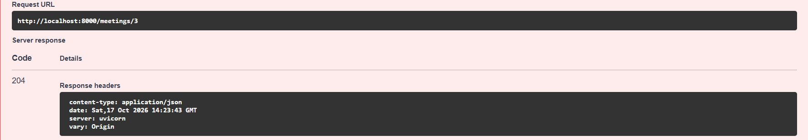
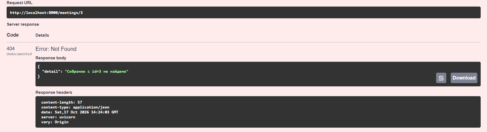

# Протоколы собраний

Веб-приложение для ведения протоколов собраний: планирование повестки, фиксация задач и дедлайнов,
ИИ-суммаризация обсуждений и аудиозаписей с выделением решений.

Проект учебный (курс «Fullstack», 1 семестр), разрабатывается поэтапно. Сейчас выполнены:
- **ЛР №1** — интерфейс и каркас frontend (на демонстрационных данных);
- **ЛР №2** — backend, API и база данных.

Подключение frontend к API — следующий этап.

## Пользовательские сценарии
1. Посмотреть список собраний и открыть протокол.
2. Создать собрание: указать название, дату, повестку, загрузить аудиозапись.
3. Прочитать ИИ-резюме и принятые решения по собранию.
4. Отследить задачи, ответственных и дедлайны.

## Экраны
| Экран | Маршрут |
|---|---|
| Список собраний | `/` |
| Протокол собрания (повестка, ИИ-резюме, решения, задачи) | `/meetings/:id` |
| Новое собрание | `/new` |
| Задачи и дедлайны | `/tasks` |

## Стек
- Frontend: React + TypeScript, Vite, React Router, MUI (Material UI).
- Backend: Python 3.11+, FastAPI, SQLAlchemy 2.0, Pydantic v2, pydantic-settings, Uvicorn.
- База данных: PostgreSQL 16.
- Тесты: pytest + httpx (backend), проверка сборки (frontend). CI: GitHub Actions.

## Структура репозитория
```
backend/
  app/
    main.py         # создание приложения, CORS, роутеры, создание таблиц при старте
    config.py       # настройки из окружения / .env
    database.py     # engine, SessionLocal, Base, зависимость get_db
    models.py       # таблицы SQLAlchemy
    schemas.py      # схемы Pydantic (запросы и ответы)
    crud.py         # операции с БД
    routers/        # meetings.py, tasks.py
  tests/            # автотесты API
  .env.example      # пример настроек без секретов
  requirements.txt, requirements-dev.txt
src/                # frontend: main.tsx, App.tsx, data.ts (демо-данные), pages/
docs/screenshots/   # скриншоты экранов
docker-compose.yml  # PostgreSQL для разработки
.github/workflows/  # автоматическая проверка (CI)
```

## Запуск frontend
Нужен Node.js 18+.
```bash
npm install
npm run dev      # http://localhost:5173
npm run build    # проверка типов и сборки
```
Пока frontend использует демонстрационные данные из `src/data.ts`.

## Запуск backend
Нужны Python 3.11+ и Docker (или установленный PostgreSQL).

```bash
# 1. Настройки окружения (в .env реальные значения, он не попадает в Git)
cp backend/.env.example backend/.env       # при желании измените пароль

# 2. База данных (из корня репозитория)
docker compose --env-file backend/.env up -d db

# 3. Зависимости и запуск (из каталога backend)
cd backend
python -m venv .venv
source .venv/bin/activate                  # Windows: .venv\Scripts\activate
pip install -r requirements.txt
uvicorn app.main:app --reload
```

- Таблицы создаются автоматически при старте приложения (`Base.metadata.create_all`);
  существующие таблицы не изменяются.
- Без Docker создайте БД и пользователя в своём PostgreSQL и впишите их в `backend/.env`.
- Запускайте `uvicorn` из каталога `backend`: именно там ищется файл `.env`.
- Документация и ручная проверка: http://localhost:8000/docs (Swagger UI).

## Модель данных
Основная сущность — собрание (`meetings`). Повестка, решения и задачи относятся к одному собранию
(связь «один ко многим»).

| Таблица | Поля |
|---|---|
| `meetings` | `id` (PK), `title`, `date`, `summary`, `audio_path` |
| `agenda_items` | `id` (PK), `meeting_id` (FK → meetings.id), `position`, `text` |
| `decisions` | `id` (PK), `meeting_id` (FK → meetings.id), `text` |
| `tasks` | `id` (PK), `meeting_id` (FK → meetings.id), `title`, `assignee`, `deadline`, `status` |

- Внешние ключи объявлены с `ON DELETE CASCADE`, а в SQLAlchemy у связей стоит `cascade="all, delete-orphan"`:
  при удалении собрания удаляются его повестка, решения и задачи.
- `tasks.status`: `in_progress` («В работе»), `done` («Готово»), `postponed` («Отложена»).
  В демо-данных frontend это булево поле `done`; при подключении к API его нужно заменить на `status`.
- В API повестка и решения передаются списками строк, разбиение на строки таблиц делает backend.

## API
| Метод | Адрес | Описание | Успех |
|---|---|---|---|
| GET | `/meetings` | список собраний (`skip`, `limit`) | 200 |
| POST | `/meetings` | создать собрание с повесткой и решениями | 201 |
| GET | `/meetings/{id}` | собрание с повесткой, решениями и задачами | 200 |
| PATCH | `/meetings/{id}` | изменить поля; переданные `agenda`/`decisions` заменяют список целиком | 200 |
| DELETE | `/meetings/{id}` | удалить собрание со связанными записями | 204 |
| GET | `/tasks` | список задач (фильтры `meeting_id`, `status`) | 200 |
| POST | `/tasks` | создать задачу (`meeting_id` в теле) | 201 |
| GET | `/tasks/{id}` | одна задача | 200 |
| PATCH | `/tasks/{id}` | изменить поля задачи | 200 |
| DELETE | `/tasks/{id}` | удалить задачу | 204 |
| GET | `/health` | проверка работы сервиса | 200 |

Ошибки:
- `404` с понятным текстом (`{"detail": "Собрание с id=9999 не найдено"}`), в том числе при создании задачи
  для несуществующего собрания;
- `422` при некорректных данных: пустое название, неверная дата или статус, нечисловой id,
  явный `null` в обязательных полях при PATCH.

## Тесты и автопроверка
Автотесты API не требуют PostgreSQL: база подменяется SQLite в памяти.

```bash
cd backend
pip install -r requirements-dev.txt
pytest -v
```

Тесты покрывают: CRUD собраний и задач, фильтры, ошибки 404 и 422, замену повестки и решений при PATCH,
каскадное удаление (после удаления собрания в `agenda_items`, `decisions`, `tasks` не остаётся его строк).

При каждом push GitHub Actions (`.github/workflows/ci.yml`) запускает `pytest` для backend
и `npm run build` для frontend.

Дополнительно API можно проверить вручную через Swagger (`/docs`) на реальном PostgreSQL.

## Скриншоты
Лежат в `docs/screenshots/`.

### Список собраний


### Протокол собрания


### Новое собрание


### Задачи и дедлайны


## Проверка на PostgreSQL
Ручная проверка API через Swagger на реальной БД. Скриншоты лежат в `docs/api-check/`.

| Проверка | Результат |
|---|---|
| Создание собрания с повесткой и решениями |  |
| Создание задачи |  |
| Чтение собрания со связанной задачей |  |
| Изменение задачи |  |
| Фильтр задач по статусу |  |
| Несуществующее собрание (404) |  |
| Пустое название (422) |  |
| `null` в обязательном поле (422) |  |
| Удаление собрания |  |
| Каскад: задача удалена вместе с собранием |  |

## Изменения интерфейса
Пока нет. Кнопка «Сохранить» на экране «Новое собрание» не сохраняет данные: это появится
после подключения frontend к API.