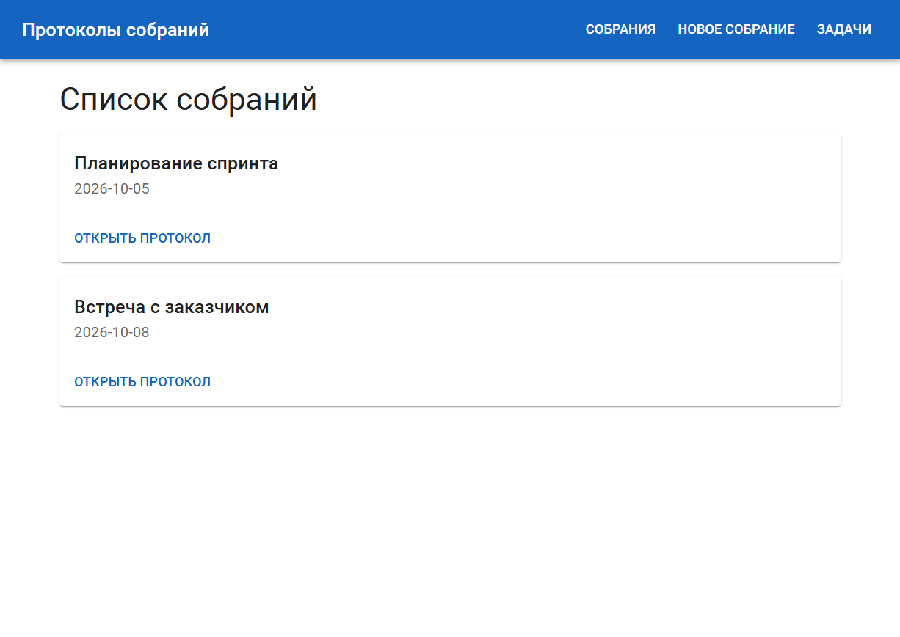
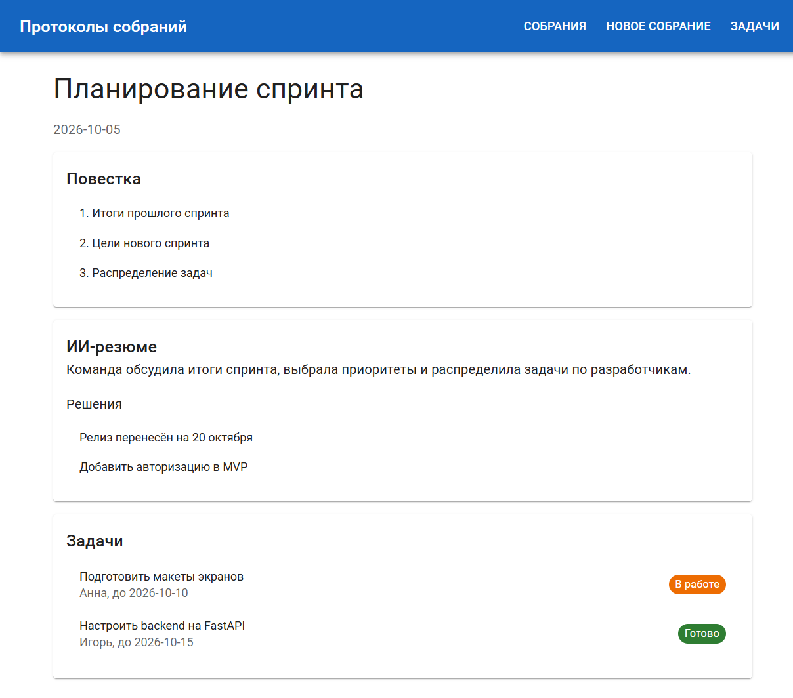
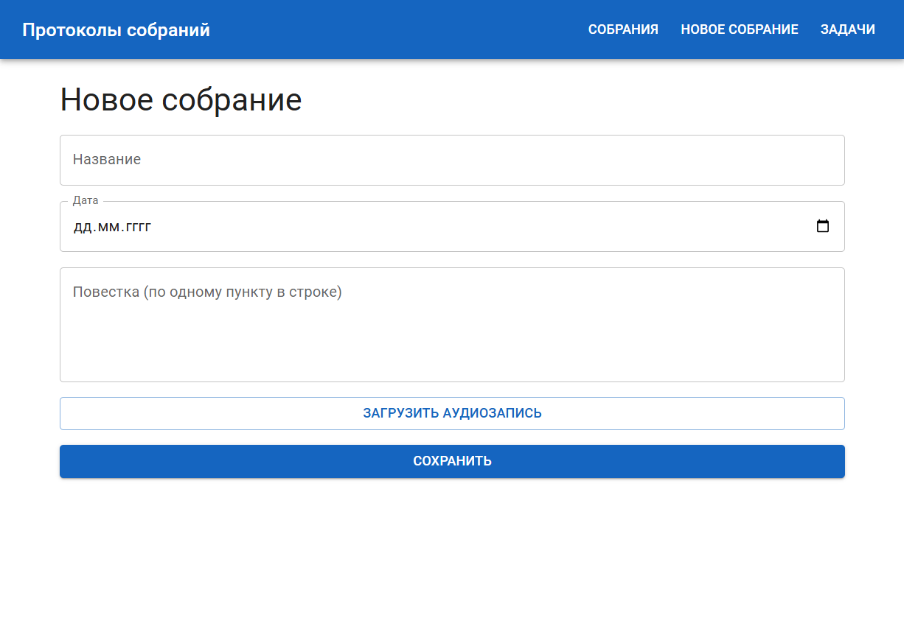
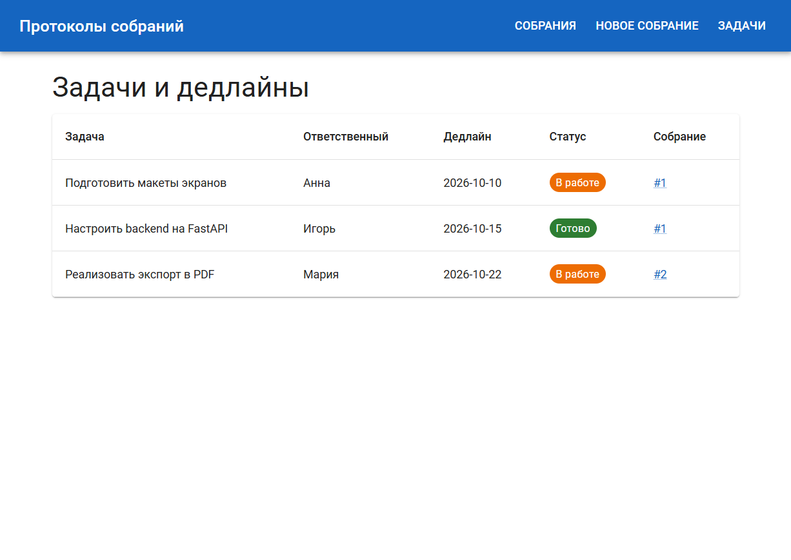

# Протоколы собраний — frontend

## Назначение
Веб-приложение для ведения протоколов собраний: планирование повестки, фиксация задач и дедлайнов,
ИИ-суммаризация обсуждений и аудиозаписей с выделением решений.

## Пользовательские сценарии
1. Посмотреть список собраний и открыть протокол.
2. Создать собрание: указать название, дату, повестку, загрузить аудиозапись.
3. Прочитать ИИ-резюме и принятые решения по собранию.
4. Отследить задачи, ответственных и дедлайны.

## Экраны
| Экран | Маршрут |
|---|---|
| Список собраний | `/` |
| Протокол собрания (повестка, ИИ-резюме, решения, задачи) | `/meetings/:id` |
| Новое собрание | `/new` |
| Задачи и дедлайны | `/tasks` |

## Стек
React + TypeScript, Vite, React Router, библиотека UI-компонентов MUI (Material UI).
Данные пока демонстрационные (`src/data.ts`), backend (FastAPI + PostgreSQL) будет подключён в следующих работах.

## Структура
```
src/
  main.tsx        # точка входа, тема MUI, роутер
  App.tsx         # шапка и маршруты
  data.ts         # демо-данные
  pages/          # страницы
docs/screenshots/ # скриншоты экранов
```

## Запуск
Нужен Node.js 18+.
```bash
npm install
npm run dev      # http://localhost:5173
npm run build    # проверка сборки
```

## Скриншоты
Лежат в `docs/screenshots/`: `meetings.png`, `meeting.png`, `new.png`, `tasks.png`.

### Список собраний


### Протокол собрания


### Новое собрание


### Задачи и дедлайны


## Изменения интерфейса
Пока нет.
